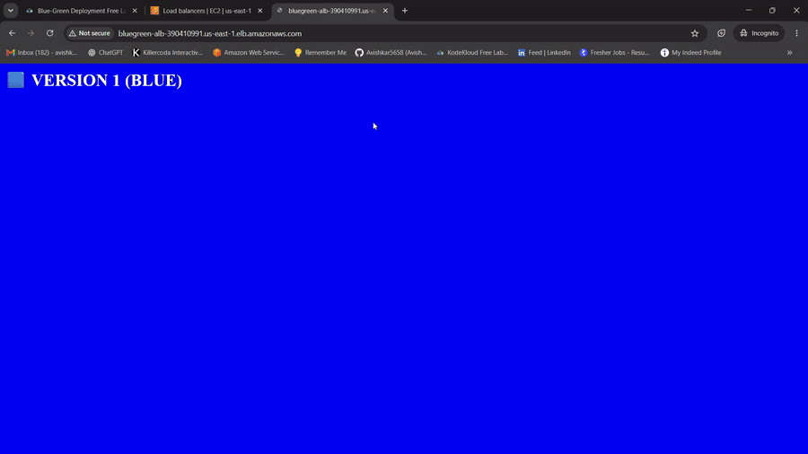
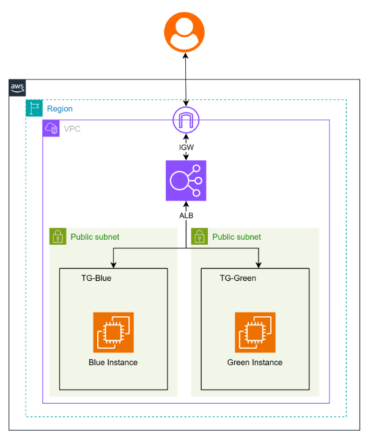
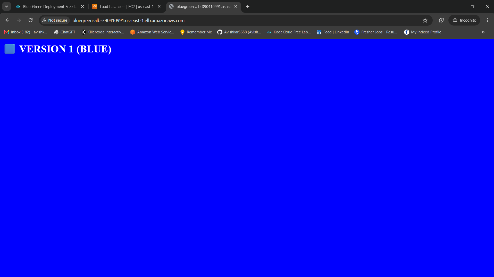
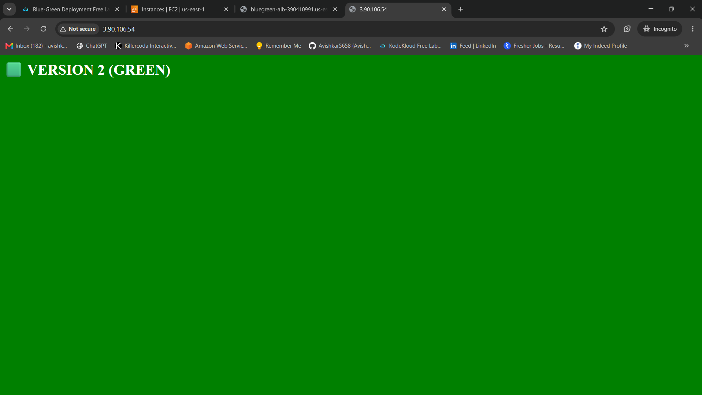
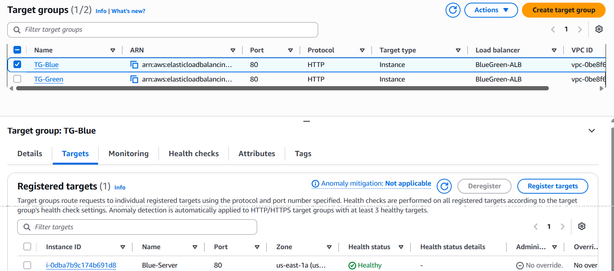
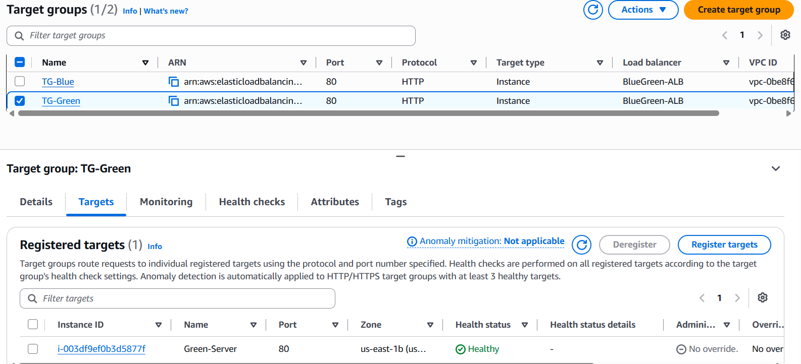
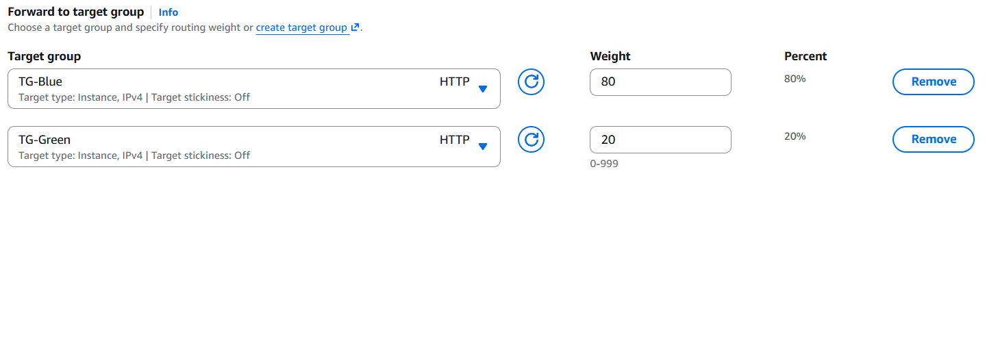

<div align="center">

# 🚀 AWS Blue-Green Deployment with Canary Traffic Shifting

### Release a new website version **safely**: no downtime, no panic, instant undo.


<br>



<sub>👆 <b>Live demo:</b> the same web address shows the old version (blue) or the new version (green), depending on the traffic percentage.</sub>

</div>

---

## 📑 Table of Contents

1. [The Problem (in plain English)]
2. [The Solution](#-the-solution)
3. [Architecture](#-architecture)
4. [AWS Services Used and Why](#-aws-services-used-and-why)
5. [How Traffic Shifting Works](#-how-traffic-shifting-works)
6. [Demo and Screenshots](#-demo-and-screenshots)
7. [Step-by-Step Implementation](#-step-by-step-implementation)
8. [Rollback Demonstration](#-rollback-demonstration)
9. [Challenges and What I Learned](#-challenges-and-what-i-learned)
10. [Cost Note and Cleanup](#-cost-note-and-cleanup)
11. [Future Improvements](#-future-improvements)
12. [Use This Project](#-use-this-project-in-your-own-repo)

---

## 🤔 The Problem (in plain English)

Imagine a popular online shop. The owner wants to change the website, maybe a new design or a new feature.

**The old way:** switch the website off, install the update, switch it back on.

- 😟 Customers see an error page while it's being updated
- 😟 If the new version has a bug, **everyone** is affected
- 😟 Fixing it takes time, and the shop loses money and trust

Big companies can't afford this. They update their websites **many times a day** without users noticing.

## 💡 The Solution

This project shows **how it's done**, using a technique called **Blue-Green Deployment** combined with **Canary releases**.

> 🍽️ **Restaurant analogy**
>
> A restaurant has **two identical kitchens**.
>
> - **Kitchen Blue** is serving all customers today (the current menu).
> - **Kitchen Green** has a new menu ready.
>
> First, only **2 out of every 10 guests** are sent to Kitchen Green to try the new menu.
> If they love it → send **more** guests. If something is wrong → send everybody **back to Blue instantly**.
>
> Nobody waits outside. Nobody is stuck with a bad meal.

| Term | Simple meaning |
|------|----------------|
| 🔵 **Blue** | The current, working version of the website |
| 🟢 **Green** | The new version being released |
| 🐤 **Canary** | Testing the new version with a *small share* of real users first (named after the canary birds once used in coal mines to detect danger early) |
| ⚖️ **Load Balancer** | The "traffic police" that decides which version each visitor gets |
| ↩️ **Rollback** | Going back to the old version quickly if something goes wrong |

### ✅ Result

**Zero-downtime releases with instant rollback**, controlled by changing a single number (the traffic percentage).

---

## 🏗️ Architecture

<div align="center">
  
</div>

**How to read the diagram (follow the arrows):**

1. 👤 A **user** opens the website address.
2. 🚪 The request enters AWS through the **Internet Gateway (IGW)**, the front door of the network.
3. ⚖️ The **Application Load Balancer (ALB)** receives it and decides where to send it.
4. 🎯 Based on the **weights** you set, it forwards the visitor to **TG-Blue** or **TG-Green** (the target groups).
5. 🖥️ A **Blue Instance** (Version 1) or a **Green Instance** (Version 2) answers with the website.

The two servers sit in **separate public subnets** (different Availability Zones), so the setup also keeps working if one zone has a problem.

---

## 🧰 AWS Services Used and Why

| Service | What it is (simple) | Why it's used here |
|---------|---------------------|--------------------|
| **Amazon VPC + Public Subnets** | Your own private network in AWS | Holds all the resources, spread across two zones |
| **Internet Gateway (IGW)** | The network's front door | Lets internet users reach the load balancer |
| **Amazon EC2** | A virtual computer in the cloud | Runs the website (`Blue-Server` and `Green-Server`) |
| **Application Load Balancer** (`BlueGreen-ALB`) | A smart traffic distributor | Gives users one address and splits traffic between versions |
| **Target Groups** (`TG-Blue`, `TG-Green`) | A "team" of servers behind the load balancer | One team per version, each with its own health checks |
| **Weighted Routing** | A percentage setting | Controls how many users see each version |
| **Security Groups** | A virtual firewall | Allows web traffic in and blocks the rest |
| **User Data Script** | A setup script that runs on first boot | Installs the web server and the website automatically |

---

## ⚖️ How Traffic Shifting Works

The release happens in **safe stages**. At every stage, check the new version before moving forward.

| Stage | 🔵 Blue (old) | 🟢 Green (new) | What happens |
|:-----:|:-------------:|:--------------:|--------------|
| **0. Start** | 100% | 0% | Everyone sees the old version. Green is ready but hidden. |
| **1. Canary** 🐤 | **80%** | **20%** | A small group tests the new version. Watch for problems. |
| **2. Half-way** | 50% | 50% | Confidence grows. Half of the users get the new version. |
| **3. Full release** | 0% | 100% | Everyone is on the new version. 🎉 |
| **↩️ Rollback** | 100% | 0% | Something wrong? Switch back in seconds. |

---

## 📸 Demo and Screenshots

### 🎬 Two versions, one address

<table>
  <tr>
    <td align="center" width="50%"><b>🔵 Version 1 (Blue)</b><br><sub>The current website</sub></td>
    <td align="center" width="50%"><b>🟢 Version 2 (Green)</b><br><sub>The new website</sub></td>
  </tr>
  <tr>
    <td></td>
    <td></td>
  </tr>
</table>

### ✅ Both servers are healthy and ready

The load balancer only sends traffic to servers that pass their **health check**. Both target groups show **Healthy** ✅

<table>
  <tr>
    <td align="center" width="50%"><b>TG-Blue</b> → <code>Blue-Server</code></td>
    <td align="center" width="50%"><b>TG-Green</b> → <code>Green-Server</code></td>
  </tr>
  <tr>
    <td></td>
    <td></td>
  </tr>
</table>

### ⚖️ The traffic control: a single setting

This is the "dial" that controls the release. Here it is set to **80% Blue / 20% Green** (the canary stage). Target stickiness is **Off**, so every refresh can land on a different version.

<div align="center">
  
</div>

### 🔁 Live traffic switching

The GIF at the top of this page shows the browser refreshing the load balancer address and alternating between **Version 1 (Blue)** and **Version 2 (Green)**, with no errors and no downtime.

---

## 🛠️ Step-by-Step Implementation

> 🌎 **Region used:** US East (N. Virginia), `us-east-1`

### ✅ Prerequisites

- An [AWS account](https://aws.amazon.com/free/) (the Free Tier covers most of this)
- Basic ability to use the AWS Console
- *(Optional)* AWS CLI installed, for the command-line steps

---

### Step 1️⃣ — Create Security Groups (the firewall rules)

| Security Group | Allow | From |
|----------------|-------|------|
| `alb-sg` | HTTP (port 80) | Anywhere (`0.0.0.0/0`) |
| `web-sg` | HTTP (port 80) | Anywhere while testing (see the hardening tip below) |

> 🔒 **Hardening tip:** once you've finished testing each server directly, change `web-sg` to accept HTTP **only from `alb-sg`**, so visitors can reach the servers only through the load balancer.

---

### Step 2️⃣ — Launch the Blue server (Version 1)

- **Service:** EC2 → Launch instance
- **Name:** `Blue-Server`
- **AMI:** Amazon Linux 2023
- **Instance type:** `t2.micro` / `t3.micro` (Free Tier eligible)
- **Subnet:** a public subnet in **`us-east-1a`**
- **Security group:** `web-sg`
- **Advanced details → User data:** paste [`user-data/blue.sh`](user-data/blue.sh)

```bash
#!/bin/bash
dnf update -y
dnf install -y httpd
systemctl enable --now httpd

cat > /var/www/html/index.html <<'HTML'
<!DOCTYPE html>
<html>
<head><title>Version 1 (Blue)</title></head>
<body style="background:blue;color:white;margin:0;padding:16px">
  <h1>🟦 VERSION 1 (BLUE)</h1>
</body>
</html>
HTML
```

---

### Step 3️⃣ — Launch the Green server (Version 2)

Repeat Step 2 with the name `Green-Server`, a public subnet in **`us-east-1b`**, and the user data from [`user-data/green.sh`](user-data/green.sh):

```bash
#!/bin/bash
dnf update -y
dnf install -y httpd
systemctl enable --now httpd

cat > /var/www/html/index.html <<'HTML'
<!DOCTYPE html>
<html>
<head><title>Version 2 (Green)</title></head>
<body style="background:green;color:white;margin:0;padding:16px">
  <h1>🟩 VERSION 2 (GREEN)</h1>
</body>
</html>
HTML
```

✅ **Test Green privately first:** open the Green server's public IP in your browser and confirm you see **Version 2 (Green)** *before* sending it any real visitors.

---

### Step 4️⃣ — Create two Target Groups

| Name | Type | Protocol / Port | Register |
|------|------|-----------------|----------|
| `TG-Blue` | Instance | HTTP : 80 | `Blue-Server` |
| `TG-Green` | Instance | HTTP : 80 | `Green-Server` |

Set the health check path to `/`. Wait until both show **Healthy** ✅ (see the screenshots above).

---

### Step 5️⃣ — Create the Application Load Balancer

- **Name:** `BlueGreen-ALB`
- **Type:** Application Load Balancer, **Internet-facing**
- **Subnets:** select the two public subnets (both Availability Zones)
- **Security group:** `alb-sg`
- **Listener:** HTTP : 80 → **Forward to target groups**
- Add **both** `TG-Blue` and `TG-Green`, with weights **Blue = 100, Green = 0**

Copy the **DNS name** of the load balancer. This is your website address.

---

### Step 6️⃣ — Start the Canary release 🐤

Edit the listener and set the weights to **Blue = 80, Green = 20**, as in the screenshot above.

Test it by refreshing the load balancer address in your browser, or from a terminal:

```bash
for i in {1..20}; do
  curl -s http://<YOUR-ALB-DNS-NAME> | grep -o "VERSION [12]"
done
```

You should see roughly **16 × Version 1** and **4 × Version 2**.

> ℹ️ **Seeing only one version?** Make sure *target stickiness* is **Off**. Otherwise your browser keeps getting the same version.

---

### Step 7️⃣ — Increase traffic gradually

Move the weights through the stages: **50 / 50**, then **0 / 100**. Verify the website at each stage before moving on.

---

### ⌨️ Bonus: Change the weights with the AWS CLI

```bash
aws elbv2 modify-listener \
  --listener-arn <LISTENER-ARN> \
  --default-actions '[{
    "Type": "forward",
    "ForwardConfig": {
      "TargetGroups": [
        {"TargetGroupArn": "<TG-BLUE-ARN>",  "Weight": 80},
        {"TargetGroupArn": "<TG-GREEN-ARN>", "Weight": 20}
      ]
    }
  }]'
```

---

## ↩️ Rollback Demonstration

Imagine the new Green version has a bug. 😱

**The fix takes seconds, not hours:**

1. Open the `BlueGreen-ALB` listener
2. Set the weights back to **TG-Blue = 100, TG-Green = 0**
3. Save ✅

All visitors are back on the working version. The Green server stays running so the team can investigate calmly.

> 💬 **Why this matters:** in the old approach, a failed update could mean an outage lasting minutes or hours. Here, recovery is a single setting change.

---

## 🎓 Challenges and What I Learned

> ✏️ *Replace the rows below with problems you actually faced. Genuine lessons stand out the most.*

| Challenge | How I solved it |
|-----------|-----------------|
| Targets showed **Unhealthy** at first | Checked the security group rules and the health check path until both turned **Healthy** |
| Always saw the same version when testing | Turned **target stickiness off** so the weighted split became visible |
| Needed to be sure Green worked before real users saw it | Opened the Green server's IP directly and tested it privately first |

**Key takeaways**

- ✅ How releases can be done **without downtime**
- ✅ How load balancers, target groups and weights work together
- ✅ Why small, gradual rollouts reduce risk
- ✅ How to design for **fast recovery** instead of only trying to avoid mistakes

---

## 💰 Cost Note and Cleanup

This project uses billable AWS resources. The **Application Load Balancer** is usually the main cost, and EC2 is covered by the Free Tier only within its limits. Check current prices on the [AWS pricing page](https://aws.amazon.com/elasticloadbalancing/pricing/).

### 🧹 Clean up when you finish (to avoid charges)

1. Delete the **Application Load Balancer** (`BlueGreen-ALB`)
2. Delete both **Target Groups** (`TG-Blue`, `TG-Green`)
3. **Terminate** both EC2 instances
4. Delete the **Security Groups**

> ⚠️ Always check the AWS Billing dashboard after cleanup.

---

## 🔮 Future Improvements

- [ ] 🏗️ Automate the whole setup with **Terraform** or **CloudFormation**
- [ ] 📈 Add **Auto Scaling Groups** for each version
- [ ] 🔔 Add **CloudWatch alarms** to detect problems automatically
- [ ] 🤖 Auto-rollback when the error rate rises
- [ ] 🚦 Use **AWS CodeDeploy** or a **CI/CD pipeline** (GitHub Actions) to run releases
- [ ] 🔐 Add **HTTPS** with AWS Certificate Manager

---

## 🔁 Use This Project in Your Own Repo

Want to try it or add it to your own portfolio?

1. **Fork** this repository (top-right button) or download it as a ZIP
2. Follow the [step-by-step guide](#-step-by-step-implementation) in your own AWS account
3. Replace the screenshots in `screenshots/` with **your own**
4. Customize the web pages (colors, text, features) in `user-data/`
5. Write your own **Challenges and What I Learned** section
6. ⭐ If it helped you, give the repo a star!

### 📁 Repository structure

```
Blue-Green-Deployment-AWS/
├── README.md
├── screenshots/
│   ├── architecture.png
│   ├── blue-version.png
│   ├── green-version.png
│   ├── blue-target-group-healthy.png
│   ├── green-target-group-healthy.png
│   ├── weights-80-20.png
│   └── demo.gif
└── EC2 Scripts Files/
    ├── blue.sh        # Version 1 setup script
    └── green.sh       # Version 2 setup script
```

---

## 👤 Author

**Avishkar Thorave**

[](https://github.com/Avishkar5658)
[](https://www.linkedin.com/in/avishkar-thorve-a77a8b2a1)

---

<div align="center">

⭐ **If you found this useful, give it a star!** ⭐

*Built with ☁️ AWS and a lot of curiosity.*

</div>
